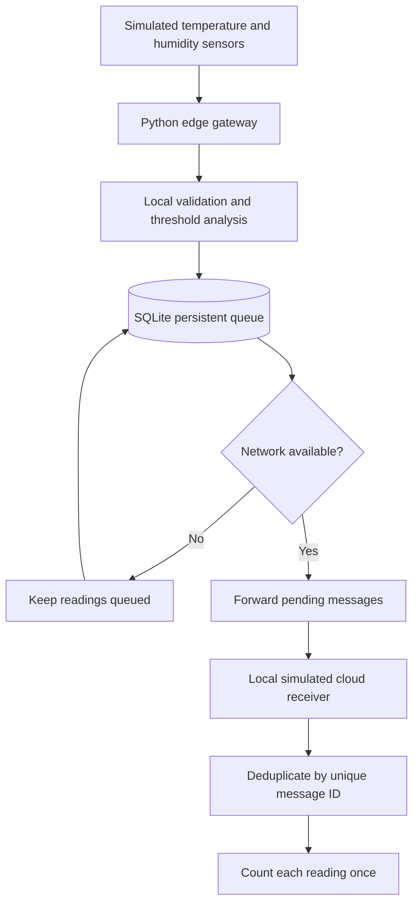

# Store-and-Forward IoT Gateway for Intermittent Networks

A hardware-free, reproducible Python simulation for demonstrating resilient IoT data collection when internet connectivity is interrupted.

## What this prototype demonstrates

- Simulated temperature and humidity readings with UTC timestamps and unique message IDs.
- Local threshold analysis (`HIGH_TEMPERATURE`, `HIGH_HUMIDITY`, or `NORMAL`).
- Persistent offline queue using SQLite.
- Simulated network outage and recovery.
- Forwarding queued readings to a local simulated cloud receiver.
- Receiver-side duplicate protection using a primary key on `message_id`.
- Metrics: data completeness, backlog recovery time, and local storage use.
- CSV message log and JSON metrics output.

**Important limitation:** This version does not connect to Azure IoT Hub. It uses a local SQLite table as a simulated receiver, which is an allowed fallback in the supplied guidelines when cloud access is unavailable. Be transparent about this during evaluation.

## Requirements

- Python 3.10 or newer (Python 3.9 may also work).
- No external Python packages required.
- No physical sensors, circuit, Jetson, or Azure subscription required for the local simulation.

## Run on Windows

1. Extract this ZIP file.
2. Open the extracted folder in File Explorer.
3. Click the address bar, type `cmd`, and press Enter.
4. Run:

```bash
python --version
python gateway.py --reset --readings 100 --outage-readings 60 --duplicate-test
```

If `python` is not recognized, install Python from https://www.python.org/downloads/ and enable **Add Python to PATH** during setup.

## Run on macOS/Linux

```bash
python3 gateway.py --reset --readings 100 --outage-readings 60 --duplicate-test
```

## Parameters

- `--readings 100`: generate 100 readings.
- `--outage-readings 60`: the first 60 readings are generated while offline; the connection is then treated as restored.
- `--delay-ms 5`: pause 5 ms between generated readings.
- `--duplicate-test`: deliberately test duplicate delivery handling.
- `--reset`: start from a clean database.

Example with a longer outage:

```bash
python gateway.py --reset --readings 200 --outage-readings 150 --delay-ms 10 --duplicate-test
```

## Output files

- `results/metrics.json`: measured metrics from the latest run.
- `results/message_log.csv`: per-message status and timestamps.
- `gateway.db`: local persistent queue and simulated receiver tables.

Do a clean run with `--reset` before collecting final results. Keep the actual generated `metrics.json` and report its values rather than using example or invented numbers.

## Architecture / data flow



## Metrics definitions

- **Data completeness (%)** = unique readings received by simulated cloud during this run / unique readings added during this run × 100.
- **Backlog recovery time (seconds)** = time spent processing pending messages after the simulated connection is restored.
- **Local storage (bytes)** = database file plus SQLite WAL/SHM sidecar file sizes at the end of the run.
- **Duplicate handling** = duplicate message IDs are rejected by the receiver table's primary key and are not counted twice.

The measured recovery time here is local processing time, not real internet reconnection time or Azure upload latency.

## Suggested evaluation procedure

1. Run `python gateway.py --reset --readings 100 --outage-readings 60 --duplicate-test`.
2. Confirm the log shows offline readings, then forwarding after recovery.
3. Open `results/metrics.json` and `results/message_log.csv`.
4. Repeat with a different outage size (e.g. 20, 60, 90) and compare recovery time and storage use.
5. Include a results table with your actual run outputs in the report.
6. State that the receiver is simulated locally; do not claim Azure integration.

## Limitations and future scope

- No physical sensor or network interface is controlled; outage is simulated by the program.
- The receiver is local, not Azure IoT Hub.
- SQLite is used as a simple local persistence layer; production deployments should consider disk encryption, access control, credential protection, retention limits, and operational monitoring.
- Future work: Azure IoT Hub integration, MQTT transport, TLS, secure secret storage, retry backoff, queue capacity management, and testing on an actual edge device.
